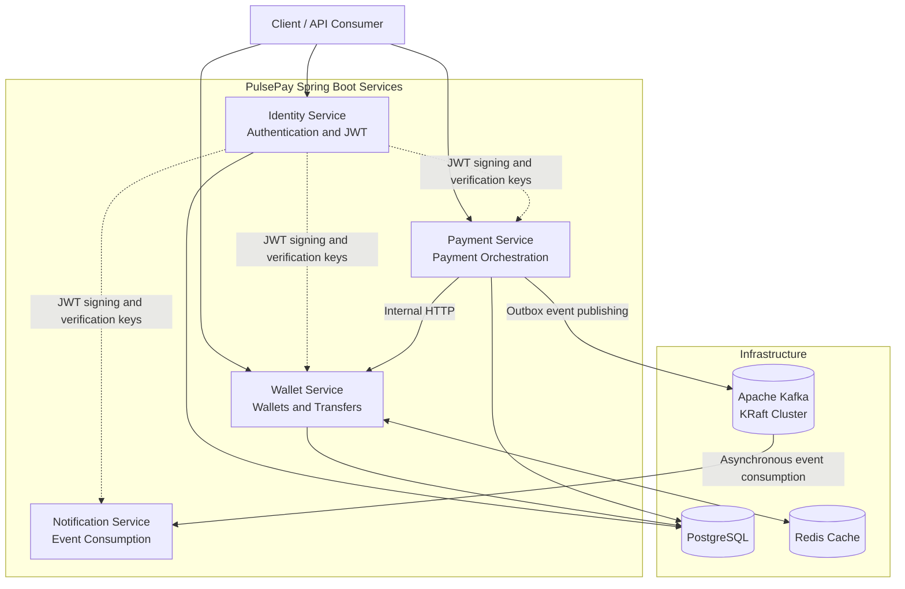
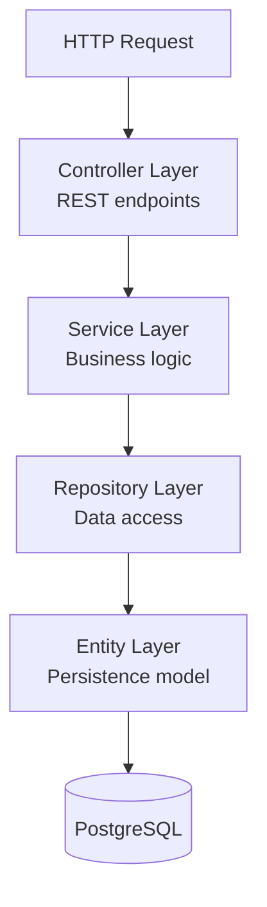
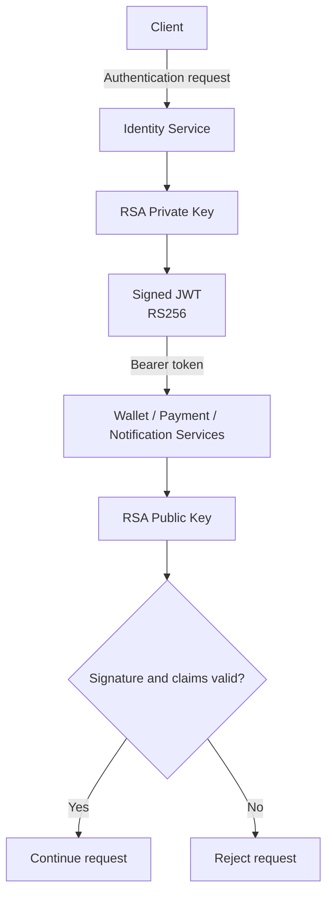
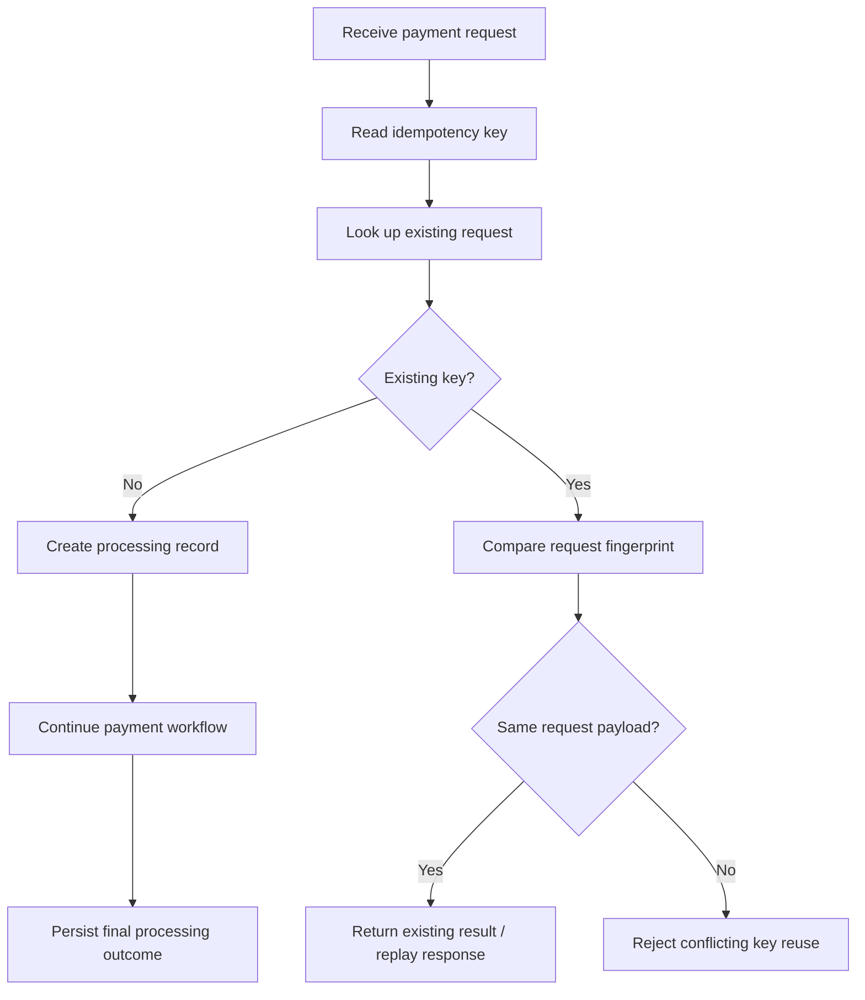
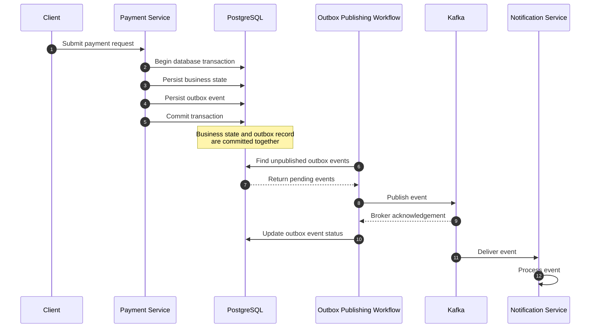
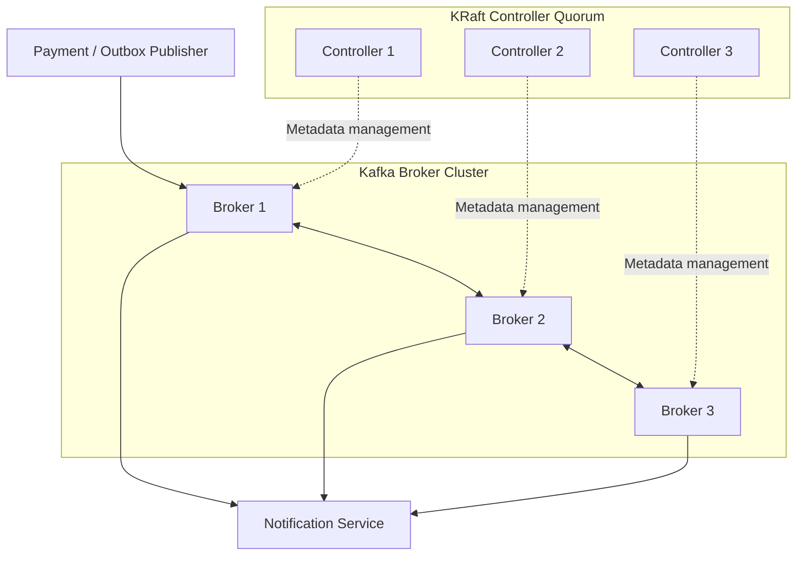
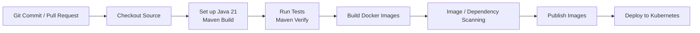
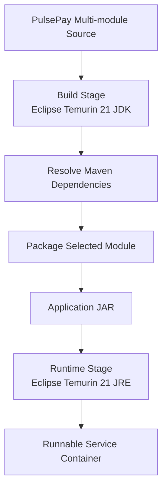
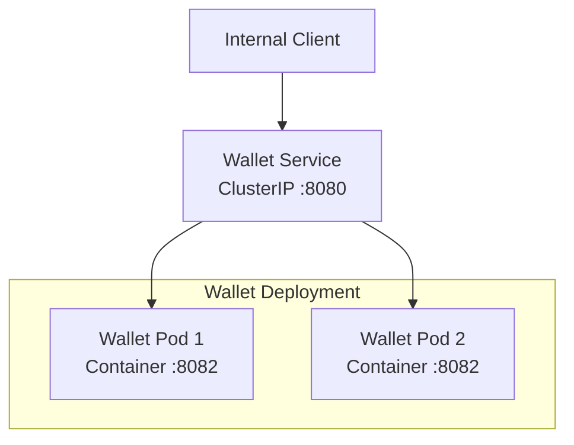

# PulsePay — Distributed Digital Wallet & Payment Platform

**Java 21 | Spring Boot 4.1.0 | Microservices | Spring Security | JPA | Hibernate | PostgreSQL | Flyway | Redis | Apache Kafka | Testcontainers | Docker | Kubernetes**

PulsePay is a modular, distributed digital wallet and payment platform built with Java 21 and Spring Boot.

The project demonstrates practical backend engineering concepts through four independently structured Spring Boot services covering identity, wallet management, payment orchestration, and notification processing.

The engineering focus is on challenges commonly encountered when building distributed backend applications:

- Preventing duplicate payment operations when clients retry requests.
- Maintaining consistency between database transactions and asynchronous events.
- Implementing secure authentication and token verification across services.
- Managing database schema evolution independently of application releases.
- Reducing repeated database access through caching.
- Handling failures and uncertain outcomes in distributed communication.
- Testing application integration with real infrastructure dependencies.
- Building reproducible container images and local environments.
- Deploying and troubleshooting containerized applications with Kubernetes.

PulsePay is designed as a technical portfolio project demonstrating practical Java backend development, application architecture, and distributed systems knowledge relevant to modern backend engineering roles.

> **Project status:** Independently developed engineering portfolio project. Features and deployment scope are documented according to the implemented code and configuration. This is not a live financial service or a production-certified payment platform.

---

# Table of Contents

1. [Architecture Overview](#1-architecture-overview)
2. [Microservices](#2-microservices)
3. [Technology Stack](#3-technology-stack)
4. [Java and Spring Backend Engineering](#4-java-and-spring-backend-engineering)
5. [Persistence: JPA, Hibernate and PostgreSQL](#5-persistence-jpa-hibernate-and-postgresql)
6. [Database Migrations with Flyway](#6-database-migrations-with-flyway)
7. [Security Architecture](#7-security-architecture)
8. [Externalized Configuration and Environment Management](#8-externalized-configuration-and-environment-management)
9. [Payment Reliability and Idempotency](#9-payment-reliability-and-idempotency)
10. [Transactional Outbox Pattern](#10-transactional-outbox-pattern)
11. [Apache Kafka and Event-Driven Architecture](#11-apache-kafka-and-event-driven-architecture)
12. [Redis Caching](#12-redis-caching)
13. [REST APIs and Internal Communication](#13-rest-apis-and-internal-communication)
14. [MapStruct](#14-mapstruct)
15. [Testing Strategy](#15-testing-strategy)
16. [Build Automation and CI/CD Scope](#16-build-automation-and-cicd-scope)
17. [Docker and Multi-stage Builds](#17-docker-and-multi-stage-builds)
18. [Kubernetes Deployment](#18-kubernetes-deployment)
19. [Application Health and Troubleshooting](#19-application-health-and-troubleshooting)
20. [Project Structure](#20-project-structure)
21. [Local Development Setup](#21-local-development-setup)
22. [Engineering Decisions and Trade-offs](#22-engineering-decisions-and-trade-offs)
23. [Failure Scenarios and Reliability](#23-failure-scenarios-and-reliability)
24. [Current Scope and Future Improvements](#24-current-scope-and-future-improvements)
25. [Engineering Focus](#25-engineering-focus)

---

# 1. Architecture Overview

PulsePay follows a microservices-oriented architecture organized as a Maven multi-module monorepo.

The platform separates four business responsibilities into independently structured Spring Boot applications.

## High-level architecture



*This is a logical architecture diagram showing the main service responsibilities and communication paths. It does not imply that every service has a separately deployed database.*

## Architectural principles

| Principle | Implementation |
|---|---|
| Service separation | Identity, Wallet, Payment and Notification services |
| Build management | Maven multi-module monorepo |
| Synchronous communication | Internal REST/HTTP communication |
| Asynchronous communication | Apache Kafka |
| Relational persistence | PostgreSQL |
| Caching | Redis |
| Schema evolution | Flyway migrations |
| Authentication | RSA-signed JWT |
| Password protection | Argon2 |
| Integration testing | Testcontainers |
| Containerization | Multi-stage Docker builds |
| Local infrastructure | Docker Compose |
| Orchestration | Kubernetes resources for Wallet Service |

## Why this architecture?

A distributed backend is more than a collection of REST controllers.

Different parts of a payment platform have different responsibilities:

- Identity handles authentication and account lifecycle.
- Wallet manages wallet-related operations.
- Payment coordinates payment workflows.
- Notification processes events asynchronously.

Separating these responsibilities makes the application easier to understand and gives each service a clearer business boundary.

It also introduces real engineering trade-offs: network failures, service dependencies, event delivery, data consistency, deployment complexity, and operational troubleshooting.

---

# 2. Microservices

| Service | Responsibilities | Main engineering concepts |
|---|---|---|
| Identity Service | Authentication and account management | Spring Security, JWT, RSA, Argon2 |
| Wallet Service | Wallet management and transfers | JPA, Hibernate, PostgreSQL, Redis, pagination |
| Payment Service | Payment orchestration | Idempotency, transactions, Outbox Pattern |
| Notification Service | Asynchronous notification-related processing | Kafka consumers and event-driven architecture |

## 2.1 Identity Service

Responsible for authentication and account-related operations.

**Implemented capabilities**

- User authentication.
- Secure password hashing.
- RSA-based JWT signing.
- Access-token and refresh-token lifecycle management.
- Refresh-token hashing before persistence.
- Account status management.
- JWT issuer configuration.

**Security implementation**

- Spring Security.
- Argon2 password hashing.
- RSA-based token signing.
- RS256 JWT verification.
- Nimbus JOSE + JWT.
- SHA-256 refresh-token hashing.

### Token configuration

| Setting | Value |
|---|---|
| Access-token lifetime | 600 seconds |
| Refresh-token lifetime | 30 days |
| JWT issuer | `pulsepay_identity_service` |
| Signing algorithm | RS256 |

The Identity Service signs access tokens using private-key material. Other services verify token signatures using the corresponding public-key material.

This separates token-signing authority from token-verification responsibilities.

Refresh tokens are generated using secure random values and persisted as hashes rather than storing their original values.

**Account lifecycle**

- `ACTIVE`
- `SUSPENDED`
- `DEACTIVATED`

## 2.2 Wallet Service

Responsible for wallet management and wallet-related business operations.

**Implemented capabilities**

- Wallet management.
- Currency-aware wallet records.
- Internal transfer operations.
- Wallet retrieval with pagination.
- Redis caching.
- RSA public-key JWT verification.

### Data integrity

A database uniqueness constraint enforces:

```sql
(account_id, currency)
```

This prevents duplicate wallet records for the same account and currency.

The constraint is enforced at the database level rather than relying exclusively on application-side validation.

### Pagination configuration

| Setting | Value |
|---|---|
| Default page size | 20 |
| Maximum page size | 100 |
| Sort order | `createdAt DESC` |

Pagination helps avoid returning unbounded collections and gives API consumers a predictable way to retrieve wallet data.

## 2.3 Payment Service

Responsible for coordinating payment workflows.

**Implemented capabilities**

- Payment request processing.
- Idempotency-key management.
- Request fingerprint validation.
- Processing-state persistence.
- Duplicate request detection.
- Replay handling.
- Stale processing recovery.
- Transactional outbox persistence.
- Internal HTTP communication with Wallet Service.

The Payment Service demonstrates an important distributed-systems principle: receiving the same client request more than once should not automatically result in performing the same business operation more than once.

## 2.4 Notification Service

Responsible for asynchronous notification-related processing.

**Implemented capabilities**

- Kafka event consumption.
- Notification-related processing.
- Event-driven service integration.
- Notification REST controller functionality.

The service separates notification-related processing from the synchronous payment request lifecycle.

---

# 3. Technology Stack

| Category | Technology |
|---|---|
| Language | Java 21 |
| Backend framework | Spring Boot 4.1.0 |
| Web | Spring MVC |
| Security | Spring Security |
| Persistence specification | Jakarta Persistence / JPA |
| ORM | Hibernate |
| Data access | Spring Data JPA |
| Query language | JPQL where implemented |
| Database | PostgreSQL 17 |
| Database migrations | Flyway |
| Transaction management | Spring transaction management |
| Mapping | MapStruct |
| Authentication | JWT / RS256 |
| Cryptography | Nimbus JOSE + JWT |
| Password hashing | Argon2 |
| Refresh-token hashing | SHA-256 |
| Caching | Redis 8.10.2 |
| Messaging | Apache Kafka 4.2.1 |
| Kafka metadata architecture | KRaft |
| Build | Maven |
| Integration testing | Testcontainers 2.0.5 |
| Containers | Docker |
| Local infrastructure | Docker Compose |
| Orchestration | Kubernetes |
| Local Kubernetes | Docker Desktop Kubernetes |
| Ingress | Traefik |
| TLS certificate management | cert-manager |
| Version control | Git / GitHub |

---

# 4. Java and Spring Backend Engineering

The services use a layered application structure to separate HTTP handling, business logic, persistence, and configuration.

## Application layers



### Controller layer

Handles incoming HTTP requests and delegates work to application services.

Controllers form the HTTP/API boundary. They should not become the place where complex business workflows are implemented.

### Service layer

Contains business operations and workflow coordination.

This is where application use cases and business rules are coordinated.

### Repository layer

Provides persistence operations through Spring Data JPA.

Repositories abstract common database access patterns and allow application services to work with persistence operations without directly managing SQL connections.

### Entity layer

Represents relational data using JPA entity mappings.

Entities describe how Java objects map to relational database structures.

### DTO layer

Separates API request and response structures from persistence entities.

This avoids unnecessarily exposing persistence models as external API contracts.

### Configuration layer

Centralizes application, security, and infrastructure configuration.

## Java and Spring concepts demonstrated

- Object-oriented programming.
- Encapsulation and separation of concerns.
- Dependency injection.
- Inversion of control.
- Interface-based design.
- Exception handling.
- Spring MVC.
- Spring Security.
- Transaction management.
- Externalized configuration.
- Repository abstraction.
- DTO-based API boundaries.
- Application configuration management.

The project is intended to demonstrate how these concepts work together in a multi-service backend rather than treating them as isolated Java topics.

---

# 5. Persistence: JPA, Hibernate and PostgreSQL

PulsePay uses PostgreSQL with Spring Data JPA and Hibernate.

| Technology | Purpose |
|---|---|
| JPA | Java persistence specification |
| Hibernate | Object-relational mapping implementation |
| Spring Data JPA | Repository abstraction |
| JPQL | Object-oriented query language, where implemented |
| PostgreSQL | Relational database engine |

JPA provides the persistence programming model. Hibernate implements that model, while Spring Data JPA simplifies common repository operations.

JPQL queries mapped entities and their attributes rather than directly querying database table names. Custom JPQL usage should be understood from the actual repository implementations.

## Database integrity

The Wallet Service enforces account-and-currency uniqueness at the database level.

This is important because application validation alone cannot prevent every concurrent request from attempting to create conflicting records.

A database constraint provides an additional integrity boundary.

## Transaction management

Spring transaction management defines transactional boundaries around business operations.

The payment and outbox workflows use transactional persistence so related database changes can be committed together.

A transaction is useful for ensuring that a group of database changes succeeds or fails as a unit. It does not automatically make operations across multiple independent services atomic.

## Hibernate configuration

The application uses the following important Hibernate settings:

```yaml
spring:
  jpa:
    hibernate:
      ddl-auto: validate
    open-in-view: false
```

### Why `ddl-auto: validate`?

Hibernate validates entity mappings against the database schema instead of automatically creating or changing the database structure.

Flyway is responsible for managing schema changes.

This keeps schema evolution explicit and version-controlled.

### Why `open-in-view: false`?

It avoids keeping the persistence context open throughout the HTTP response lifecycle.

It encourages developers to define appropriate transaction boundaries and retrieve the data needed by the application service before response serialization.

---

# 6. Database Migrations with Flyway

Flyway manages database schema evolution through version-controlled SQL migration scripts.

The application does not rely on Hibernate to automatically create or modify database tables.

## Engineering benefits

- Version-controlled schema changes.
- Explicit database evolution.
- Ordered migrations.
- Reproducible database setup.
- Separation between schema management and ORM mapping.
- Better control over database changes across application versions.

The project includes versioned migrations, including the Payment Service outbox migration identified as `V8`.

Flyway manages schema changes, while Hibernate validates the resulting schema against application entities.

This separation is useful because database structure is an important part of application behavior and should be reviewed and maintained alongside source code.

---

# 7. Security Architecture

Security is implemented as a cross-service concern.

## RSA-based JWT authentication

The Identity Service signs JWT access tokens using an RSA private key.

Other services verify token signatures using public-key material.



This separates token-signing authority from token-verification responsibilities.

The private key must remain protected. Services that only verify tokens should not need access to the private signing key.

## Password protection

Argon2 is used to hash passwords rather than storing plaintext or reversibly encrypted passwords.

Password hashing is designed to make recovering the original password computationally difficult.

## Refresh-token protection

Refresh tokens are:

- Generated using secure random values.
- Hashed using SHA-256.
- Persisted as hashes.
- Managed through the refresh-token lifecycle.

Persisting a hash rather than the original refresh token reduces exposure if the stored token data is compromised.

## Externalized secrets and configuration

Sensitive configuration is not intended to be hardcoded in application source code.

The application uses environment-based configuration for values such as database credentials and JWT signing-key material.

Private keys and credentials must not be committed to Git.

---

# 8. Externalized Configuration and Environment Management

PulsePay separates application configuration from application code.

This is important when the same service must run in different environments, such as:

- A developer workstation.
- Docker Compose.
- A Kubernetes deployment.
- A future production environment.

The application reads configuration through environment variables and Spring Boot property placeholders.

## PostgreSQL configuration

The application configuration uses:

```text
SPRING_DATASOURCE_URL
SPRING_DATASOURCE_USERNAME
SPRING_DATASOURCE_PASSWORD
```

## JWT configuration

The Identity Service uses:

```text
PULSEPAY_JWT_PRIVATE_KEY
```

The corresponding public-key configuration is used by services that verify JWT signatures.

## PowerShell environment configuration

For local Windows development, environment variables can be supplied through PowerShell.

Example:

```powershell
$env:SPRING_DATASOURCE_URL = "jdbc:postgresql://localhost:5433/pulsepay"
$env:SPRING_DATASOURCE_USERNAME = "postgres"
$env:SPRING_DATASOURCE_PASSWORD = "your-local-password"
```

The variables are inherited by applications launched from that PowerShell session.

For example, the Maven verification command can be run from the repository root:

```powershell
.\mvnw.cmd clean verify
```

This allows Maven-launched Spring Boot applications to read the configured values.

**Important:** PowerShell `$env:` variables are process-scoped. They disappear when that PowerShell session closes.

For persistent Windows user-level settings, PowerShell supports:

```powershell
[Environment]::SetEnvironmentVariable(
    "VARIABLE_NAME",
    "VALUE",
    "User"
)
```

A new terminal session is required to read newly persisted user-level variables.

## Configuration across environments

| Environment | Configuration approach |
|---|---|
| Local development | PowerShell environment variables |
| Docker Compose | Environment variables and Compose configuration |
| Kubernetes | Deployment configuration and Kubernetes resources |
| Production deployment | Platform-managed environment configuration and secret management |

**Security principle:** Production private keys, passwords, and credentials should be supplied through a dedicated secret-management system or protected deployment secret mechanism. They should not be stored in source control or embedded in container images.

---

# 9. Payment Reliability and Idempotency

Payment workflows must handle client retries and uncertain request outcomes.

Consider this situation:

1. A client sends a payment request.
2. The server processes the request successfully.
3. The server's response is lost because of a network interruption.
4. The client does not know whether the payment succeeded.
5. The client retries the request.

Without idempotency, the retry could result in duplicate processing.

PulsePay implements idempotency handling to address this problem.

## Implemented concepts

- Idempotency keys.
- Request fingerprinting.
- Processing-state persistence.
- Duplicate request detection.
- Replay handling.
- Stale processing recovery.

The request fingerprint helps distinguish a retry of the original operation from a different request attempting to reuse the same key.

## Idempotency flow



*This is a logical representation of the idempotency decision process.*

## Why request fingerprinting matters

An idempotency key identifies a logical request.

However, a client might accidentally reuse the same key with a different amount or payload.

The fingerprint helps detect that situation.

For example:

| Request | Idempotency key | Payload | Expected handling |
|---|---|---|---|
| First request | `payment-123` | Amount 100 | Process |
| Retry | `payment-123` | Amount 100 | Replay existing outcome |
| Different request | `payment-123` | Amount 500 | Reject conflicting reuse |

The values above are illustrative examples, not actual stored production records.

## Stale processing recovery

| Configuration | Value |
|---|---|
| Stale threshold | 60 seconds |
| Recovery interval | 30 seconds |

The recovery mechanism identifies processing records that remain in a processing state beyond the configured threshold.

A timeout alone does not prove that a business operation failed. Recovery must consider the underlying operation's state before deciding what action is safe.

This distinction is important in distributed systems because a service may lose communication with another service even though the original operation has already completed.

---

# 10. Transactional Outbox Pattern

A distributed application may need to update a database and publish a Kafka event as part of one business workflow.

These operations involve different systems and cannot automatically be treated as one atomic transaction.

Consider the dual-write problem:

- The database transaction succeeds, but publishing the event fails.
- The event is published, but the database transaction fails.

Either situation can leave the application with inconsistent business state and event information.

PulsePay uses the Transactional Outbox Pattern to address this dual-write problem.

## Outbox workflow



*This diagram illustrates the logical outbox workflow. It does not assert a particular polling implementation or guarantee exactly-once delivery.*

## Workflow

1. Execute the business operation.
2. Persist the business-state change.
3. Persist the corresponding outbox event in the same database transaction.
4. Commit the transaction.
5. Publish the persisted event to Kafka through the outbox publishing workflow.
6. Update the outbox event's status as appropriate.
7. Allow the downstream consumer to process the event asynchronously.

## Implemented elements

- Outbox database migration.
- Outbox event status management.
- Transactional outbox persistence.
- Transfer completion record handling.
- Kafka event integration.

## Why the Outbox Pattern matters

The business-state change and its corresponding outbox record are committed together in the same database transaction.

If the transaction rolls back, both changes roll back.

If it commits, the event remains persisted and can be published by the outbox workflow, even if Kafka is temporarily unavailable.

The outbox improves consistency between database commits and event publication intent.

It does not guarantee end-to-end exactly-once delivery. Duplicate event publication and consumer-side deduplication remain important distributed-systems considerations.

---

# 11. Apache Kafka and Event-Driven Architecture

Apache Kafka provides asynchronous communication for PulsePay.

The Payment Service uses the outbox workflow to publish payment-related events, and the Notification Service consumes events independently of the synchronous payment request.

## Kafka KRaft architecture

The local Kafka environment uses KRaft rather than ZooKeeper.

KRaft uses Kafka's own controller quorum to manage cluster metadata.

## Configured topology

| Setting | Configuration |
|---|---|
| Controllers | 3 |
| Brokers | 3 |
| Replication factor | 3 |
| Minimum in-sync replicas | 2 |
| Automatic topic creation | Disabled |
| Unclean leader election | Disabled |
| Kafka version | 4.2.1 |

## Logical KRaft architecture



*This is a conceptual cluster diagram. Actual partition placement and replica assignments are determined by the Kafka configuration and cluster metadata.*

## Engineering concepts

### Brokers

Kafka brokers store and serve topic partitions.

### Controllers

KRaft controllers manage cluster metadata and coordination.

### Replication

A replication factor of three configures three replicas for each replicated partition.

### Minimum in-sync replicas

A minimum ISR of two establishes a requirement for in-sync replicas under the relevant producer acknowledgement configuration.

The producer acknowledgement setting also matters when reasoning about durability.

### Automatic topic creation disabled

Prevents unexpected topics from being created automatically.

### Unclean leader election disabled

Avoids promoting an out-of-sync replica merely to restore availability when doing so could risk losing acknowledged data.

## Event-driven communication

Kafka separates event production from event consumption.

This allows notification processing to happen independently of the main payment request lifecycle.

The multi-broker configuration demonstrates Kafka topology and replication concepts in the local development environment. It is not a claim of production Kafka operational readiness.

---

# 12. Redis Caching

Redis is integrated into the Wallet Service to reduce repeated database reads.

## Local Redis environment

The local Redis environment includes:

- Redis 8.10.2.
- Password-based authentication.
- Persistent Docker volume configuration.
- Container health checks.
- Application-level wallet caching.

Caching helps reduce unnecessary database access for suitable read operations.

The database remains the persistent source of business data.

## Cache considerations

Caching introduces additional engineering responsibilities:

- Cache invalidation.
- Cache expiration.
- Stale data.
- Cache misses.
- Consistency between the cache and database.
- Handling Redis availability problems.

A cache should improve read performance without becoming the authoritative source of financial business data.

---

# 13. REST APIs and Internal Communication

The services use Spring MVC REST controllers.

The Payment Service communicates with the Wallet Service using internal HTTP communication.

The service URL is externalized using:

```text
PULSEPAY_WALLET_SERVICE_URL
```

The Docker Compose configuration uses the Wallet Service's internal Docker network address.

For example, the internal service address is:

```text
http://wallet-service:8082
```

The host-side port and the container-side port are not necessarily the same.

This distinction matters when debugging Docker networking and Kubernetes Services.

## Controller inventory

| Service | Controller |
|---|---|
| Identity Service | `AuthenticationController` |
| Identity Service | `IdentityAccountController` |
| Wallet Service | `WalletController` |
| Wallet Service | `TransferController` |
| Wallet Service | `InternalTransferController` |
| Payment Service | `PaymentController` |
| Notification Service | `NotificationController` |

The controllers represent the REST API surface.

Exact HTTP methods, endpoint paths, validation rules, and response schemas should be taken from their actual mappings.

## Internal service communication

Internal HTTP communication introduces familiar distributed-system concerns:

- Network failures.
- Service unavailability.
- Request timeouts.
- Invalid responses.
- Authentication between services.
- Retry safety.
- Duplicate request handling.

A retry should only be introduced where the operation is safe to retry or protected by an appropriate idempotency mechanism.

---

# 14. MapStruct

MapStruct is included for compile-time object mapping.

It supports separation between persistence entities and API-facing DTOs.

This helps avoid exposing persistence models directly as external API contracts and reduces repetitive manual mapping code where mappings are defined.

Compile-time mapping also helps identify certain mapping problems during the build rather than discovering them only at runtime.

---

# 15. Testing Strategy

PulsePay uses automated tests to validate application behavior.

## Testing technologies

- JUnit-based tests.
- Spring Boot testing infrastructure.
- Testcontainers 2.0.5.
- Containerized infrastructure dependencies.
- Maven verification lifecycle.

## Testcontainers

Testcontainers provides containerized dependencies for integration testing.

The project uses real infrastructure dependencies rather than relying exclusively on mocked infrastructure.

Testing includes integration with:

- PostgreSQL.
- Redis.
- Kafka.

This helps validate interactions between application code and infrastructure components.

## Why integration testing matters

Unit tests and integration tests answer different questions.

| Test type | What it helps validate |
|---|---|
| Unit tests | Individual classes and isolated business logic |
| Integration tests | Interactions between application components |
| Infrastructure integration tests | Application behavior with real infrastructure dependencies |

For example, a repository test using a real PostgreSQL container can validate persistence behavior against an actual database engine rather than relying only on mocks.

## Maven verification

The multi-module project has successfully completed the Maven verification build.

Run from the repository root:

```powershell
.\mvnw.cmd clean verify
```

The Maven Wrapper ensures the project can use its configured Maven distribution without requiring a separate global Maven installation.

The integration-test work and successful verification build are part of the project's completed implementation.

---

# 16. Build Automation and CI/CD Scope

PulsePay currently includes automated testing and Maven build verification.

The following distinction is important:

| Capability | Status |
|---|---|
| Maven multi-module build | Implemented |
| Automated test execution through Maven | Implemented |
| Testcontainers integration testing | Implemented |
| Maven `clean verify` | Verified |
| Docker multi-stage image builds | Implemented |
| Docker Compose environment | Implemented |
| GitHub Actions CI pipeline | Future improvement |
| Automated image publishing | Future improvement |
| Automated deployment pipeline | Future improvement |

## Potential CI/CD workflow

A future CI/CD pipeline can automate:



*This diagram represents a proposed future pipeline, not an implemented GitHub Actions workflow.*

The repository does not currently claim that these CI/CD stages have been implemented.

---

# 17. Docker and Multi-stage Builds

PulsePay uses a shared multi-stage Dockerfile to package the four services.

The build accepts a `MODULE` argument, allowing one Dockerfile to build different application modules.

## Multi-stage build architecture



## Build stage

```dockerfile
FROM eclipse-temurin:21-jdk AS build
```

The build stage:

- Uses a Java 21 JDK.
- Copies Maven Wrapper files.
- Copies POM files before application source code.
- Resolves Maven dependencies.
- Copies module source code.
- Packages the selected module.

## Runtime stage

```dockerfile
FROM eclipse-temurin:21-jre
```

The runtime stage:

- Uses a Java runtime image.
- Copies the packaged application JAR.
- Excludes the build environment.
- Runs the application using `java -jar`.

## Docker layer caching

POM files are copied before application source code to improve dependency-layer caching.

This means dependency layers can be reused when application source changes but dependency definitions remain unchanged.

The dependency-resolution command is:

```bash
./mvnw -pl ${MODULE} -am dependency:go-offline
```

The packaging command is:

```bash
./mvnw -pl ${MODULE} -am clean package -DskipTests
```

The image build skips tests because automated verification is handled separately in the Maven workflow.

## Docker Compose

The local environment includes:

- Four Spring Boot services.
- PostgreSQL 17.
- Redis 8.10.2.
- Apache Kafka 4.2.1.
- Three Kafka controllers.
- Three Kafka brokers.
- Persistent infrastructure volumes.
- Container health checks.
- Internal service networking.

Docker Compose provides a reproducible local environment for running the application and its supporting infrastructure.

---

# 18. Kubernetes Deployment

PulsePay includes Kubernetes resources for the Wallet Service.

The local Kubernetes environment uses Docker Desktop Kubernetes.

## Current manifests

```text
k8s/
├── wallet-deployment.yaml
└── wallet-service.yaml
```

## Wallet Deployment

The deployment configures:

- Two desired replicas.
- Pod labels and selectors.
- Container image configuration.
- Image pull policy.
- Application port 8082.

A Deployment manages the desired number of application Pods and supports controlled updates to the workload.

## Wallet Service

The Kubernetes Service uses `ClusterIP`.

| Setting | Value |
|---|---|
| Service type | `ClusterIP` |
| Service port | `8080` |
| Target container port | `8082` |

This provides stable internal service networking and routes traffic to matching Pods.

## Kubernetes networking



The Service provides a stable network endpoint even when individual Pods are replaced.

The Service port is the port exposed by the Kubernetes Service. The target port is the port on which the application container receives traffic.

## Application health endpoints

The Wallet Service exposes Spring Boot Actuator health endpoints used during application health checks:

```text
/actuator/health
/actuator/health/liveness
/actuator/health/readiness
```

The Kubernetes probe configuration should be verified in the current deployment manifest before claiming that startup, liveness, and readiness probes are all configured.

### What the probes mean

| Probe | Purpose |
|---|---|
| Startup | Gives an application time to initialize before other probe checks take over |
| Liveness | Determines whether a container should be restarted |
| Readiness | Determines whether a Pod should receive traffic |

These are different checks and solve different operational problems.

## Image tags and pull policies

One important deployment lesson from PulsePay was the interaction between image tags and `imagePullPolicy: IfNotPresent`.

When a local image is rebuilt using the same `latest` tag, Kubernetes may continue using an image already available locally.

Changing to a unique image tag helps make the deployed version explicit.

For example:

```text
identity-service-wallet-service:health-fix-20261112
```

The important lesson is that a successful Docker build does not automatically mean the running Kubernetes Pod is using that newly built image.

## Additional Kubernetes experience

- Deployments and replica management.
- Pods.
- Labels and selectors.
- ClusterIP Services.
- Container ports and target ports.
- Image tags and image pull policies.
- Application health endpoints.
- Port-forwarding.
- Deployment inspection.
- Container logs.
- Service selectors and port mappings.
- Application health troubleshooting.
- Traefik and cert-manager installation in the local Kubernetes environment.

**Scope clarification:** The current repository contains Kubernetes manifests for the Wallet Service only. The entire four-service application is not yet represented by Kubernetes deployment manifests.

---

# 19. Application Health and Troubleshooting

Spring Boot Actuator provides application health endpoints used when checking the Wallet Service.

```text
/actuator/health
/actuator/health/liveness
/actuator/health/readiness
```

The project also involves practical deployment troubleshooting, including:

- Inspecting deployment specifications.
- Verifying container image names and tags.
- Understanding image pull policies.
- Inspecting Pod status.
- Reading application logs.
- Checking Service selectors and port mappings.
- Testing application health endpoints.
- Understanding the difference between a running container and a healthy application.

## Example Kubernetes troubleshooting commands

Inspect the deployed image:

```powershell
kubectl get deployment wallet-service -o=jsonpath="{.spec.template.spec.containers[0].image}"
```

Inspect the Deployment:

```powershell
kubectl describe deployment wallet-service
```

Inspect Pods:

```powershell
kubectl get pods -l app=wallet-service
```

Inspect application logs:

```powershell
kubectl logs deployment/wallet-service
```

Inspect the Kubernetes Service:

```powershell
kubectl describe service wallet-service
```

Forward a local port to the Service:

```powershell
kubectl port-forward service/wallet-service 8080:8080
```

Test the health endpoint from another terminal:

```powershell
curl.exe http://localhost:8080/actuator/health
```

These commands help investigate different parts of the deployment:

| Diagnostic area | What it helps establish |
|---|---|
| Deployment image | Which image the Deployment requests |
| Deployment description | Configuration and rollout details |
| Pod status | Whether Pods are running or failing |
| Container logs | What the application reports |
| Service description | How traffic is routed |
| Port-forwarding | Whether the application can be reached locally |
| Actuator health | Whether the application reports a healthy state |

The project demonstrates the difference between a successful application build and a successfully running application.

---

# 20. Project Structure

The repository is organized as a Maven multi-module project.

```text
pulsepay/
│
├── identity-service/
│   ├── src/
│   │   ├── main/
│   │   └── test/
│   └── pom.xml
│
├── wallet-service/
│   ├── src/
│   │   ├── main/
│   │   └── test/
│   └── pom.xml
│
├── payment-service/
│   ├── src/
│   │   ├── main/
│   │   └── test/
│   └── pom.xml
│
├── notification-service/
│   ├── src/
│   │   ├── main/
│   │   └── test/
│   └── pom.xml
│
├── k8s/
│   ├── wallet-deployment.yaml
│   └── wallet-service.yaml
│
├── redis/
│   └── redis.conf
│
├── .mvn/
├── .env
├── .gitignore
├── Dockerfile
├── docker-compose.yml
├── mvnw
├── mvnw.cmd
├── pom.xml
└── README.md
```

The root Maven POM manages the multi-module build, while each service has its own module POM and source structure.

Sensitive local configuration and key material are intended to remain outside version control.

---

# 21. Local Development Setup

## Prerequisites

- Java 21.
- Docker Desktop.
- Docker Compose.
- Git.
- Windows PowerShell or a compatible terminal.

Maven does not need to be installed separately because the repository includes Maven Wrapper.

## Clone the repository

```bash
git clone https://github.com/blueskysagar/pulsepay.git
cd pulsepay
```

## Configure environment variables

Set the required database, JWT, Redis, Kafka, and service configuration values according to the application's configuration.

For local development, use appropriate local credentials and key material.

Do not commit private keys, passwords, or sensitive environment files.

## Verify the Maven project

Run from the repository root:

```powershell
.\mvnw.cmd clean verify
```

This executes the Maven verification lifecycle across the configured modules.

## Start the application environment

```bash
docker compose up --build
```

## Inspect containers

```bash
docker compose ps
```

## Follow logs

```bash
docker compose logs -f
```

## Stop the environment

```bash
docker compose down
```

To remove associated volumes:

```bash
docker compose down -v
```

**Warning:** Removing volumes deletes their persistent local data.

---

# 22. Engineering Decisions and Trade-offs

Engineering decisions are rarely free. Every technology introduces benefits and responsibilities.

| Decision | Reason | Trade-off |
|---|---|---|
| Microservices | Separate business responsibilities | Distributed communication complexity |
| Maven monorepo | Centralized dependency and build management | Shared parent configuration |
| PostgreSQL | Relational integrity and transactional persistence | Requires deliberate schema and query management |
| Spring Data JPA | Simplified persistence access | ORM behavior and generated SQL need understanding |
| Hibernate validation | Explicit schema management | Migrations must be maintained |
| Flyway | Version-controlled database changes | Migration ordering and compatibility |
| RSA JWT | Separate signing and verification | Key distribution and rotation |
| Argon2 | Secure password hashing | Computationally expensive verification |
| Idempotency | Prevent duplicate request processing | Persistent request state |
| Transactional Outbox | Consistent database and event intent | Additional publishing workflow |
| Kafka | Asynchronous service communication | Broker and consumer management |
| Redis | Reduce repeated database reads | Cache invalidation and consistency |
| Testcontainers | Real infrastructure integration tests | Container runtime requirements |
| Multi-stage Docker | Separate build and runtime environments | More sophisticated image configuration |
| Kubernetes | Container orchestration | Operational complexity |

Understanding these trade-offs is important.

For example, microservices can improve separation of responsibilities, but they also introduce network failures and deployment complexity that do not exist in the same way inside a single-process monolith.

Likewise, caching can reduce repeated database reads, but it creates additional consistency and invalidation responsibilities.

---

# 23. Failure Scenarios and Reliability

The project uses reliability-oriented patterns to address common distributed application problems.

| Scenario | Engineering approach |
|---|---|
| Client retries after a lost response | Idempotency handling |
| Same idempotency key with a different payload | Request fingerprint validation |
| Payment remains in processing state | Stale processing recovery |
| Database commit succeeds but event publishing fails | Transactional Outbox |
| Kafka is temporarily unavailable | Persisted outbox event provides a basis for retry |
| Repeated wallet data reads | Redis caching |
| Database schema changes | Flyway migrations |
| Application starts slowly | Startup probe concept |
| Application becomes unhealthy | Liveness probe concept |
| Application cannot accept traffic | Readiness probe concept |

## Important distributed-systems considerations

### 1. A timeout does not prove failure

A client may time out even though the server completed the operation.

The correct response is to determine the existing operation's state rather than blindly performing it again.

### 2. Database transactions do not span independent services automatically

A transaction in one service does not automatically make an HTTP call to another service part of the same atomic database transaction.

### 3. Event delivery can produce duplicates

A publisher may successfully send an event but fail before recording that publication was completed.

The event can then be published again.

Consumers should be designed with duplicate handling in mind.

### 4. Cache data can become stale

A cache is an optimization, not the authoritative source of business data.

Cache invalidation and consistency must be considered whenever underlying wallet data changes.

### 5. Replication does not eliminate every failure

Kafka replication helps with broker failures, but durability also depends on producer acknowledgement settings, replication state, and operational configuration.

The project demonstrates reliability-oriented engineering patterns, but production operation would require additional testing of concurrency, failure recovery, monitoring, security, and disaster recovery.

---

# 24. Current Scope and Future Improvements

PulsePay is an engineering portfolio project rather than a live production payment service.

## Current implemented scope

- Four independently structured Spring Boot services.
- Java 21 and Spring Boot 4.1.0.
- PostgreSQL persistence.
- Spring Data JPA and Hibernate.
- Flyway migrations.
- RSA JWT authentication.
- Argon2 password hashing.
- Refresh-token hashing.
- Redis caching.
- Kafka event-driven communication.
- Idempotency and request fingerprinting.
- Stale processing recovery.
- Transactional outbox persistence.
- Testcontainers integration testing.
- Maven multi-module verification.
- Docker multi-stage builds.
- Docker Compose infrastructure.
- Wallet Service Kubernetes deployment resources.
- Local Kubernetes troubleshooting experience.
- Externalized application configuration.

## Potential future improvements

| Area | Potential improvement |
|---|---|
| Kubernetes | Manifests for all four services |
| CI/CD | GitHub Actions build and test pipeline |
| Container delivery | Automated Docker image publishing |
| Deployment | Automated Kubernetes deployment |
| Observability | Prometheus and Grafana |
| Distributed tracing | OpenTelemetry |
| Logging | Centralized structured logging |
| Kafka reliability | Retry and dead-letter topic strategies |
| Consumer reliability | Stronger consumer-side deduplication |
| API documentation | OpenAPI documentation |
| Performance | Load and performance testing |
| Security | Container vulnerability scanning |
| Secrets | Production secret management and key rotation |
| Resilience | More comprehensive timeout and retry policies |
| Operations | Disaster recovery and deployment rollback automation |

These are future improvements, not features currently claimed as implemented.

---

# 25. Engineering Focus

PulsePay demonstrates practical work with:

- Designing service boundaries in a microservices architecture.
- Implementing secure authentication across services.
- Building Java persistence layers using JPA and Hibernate.
- Managing relational schemas with Flyway.
- Understanding database transactions and integrity constraints.
- Preventing duplicate payment operations through idempotency.
- Applying the Transactional Outbox Pattern.
- Integrating Apache Kafka for asynchronous processing.
- Using Redis for read optimization.
- Testing infrastructure integration with Testcontainers.
- Building multi-stage Docker images.
- Deploying and troubleshooting applications with Kubernetes.
- Externalizing application configuration and sensitive values.
- Understanding reliability trade-offs in distributed systems.
- Distinguishing application-level correctness from infrastructure-level availability.

The objective is to demonstrate not only the ability to build REST APIs, but also the ability to reason about security, persistence, distributed communication, failure handling, and maintainability.

The project is intended to reflect the technical breadth and engineering reasoning expected in modern mid-level Java backend development. It is a portfolio demonstration, not a claim of equivalent professional industry experience.

---

## Author

**Sagar Shrestha**

GitHub: [@blueskysagar](https://github.com/blueskysagar)

Repository: [PulsePay — Distributed Digital Wallet & Payment Platform](https://github.com/blueskysagar/pulsepay)
